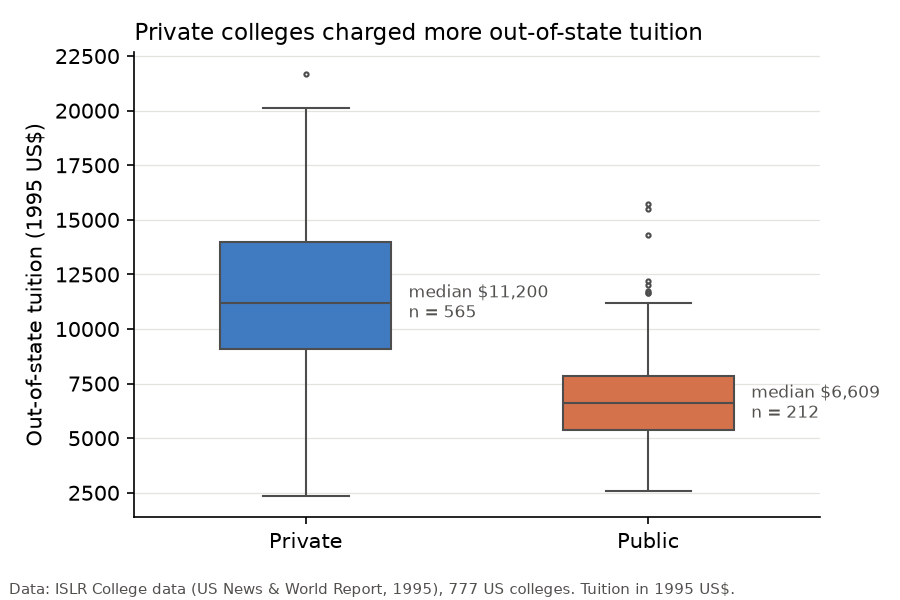
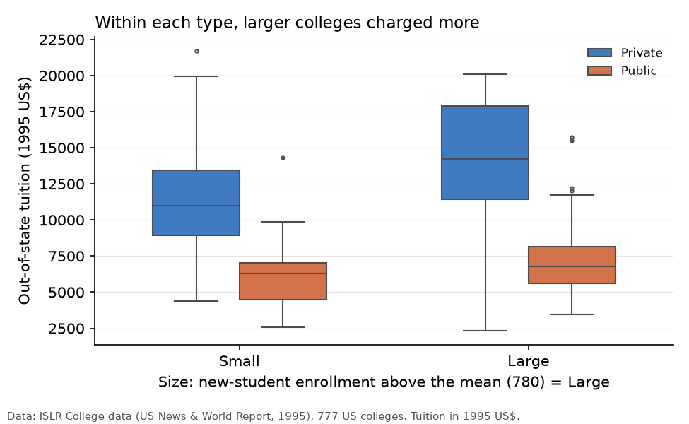
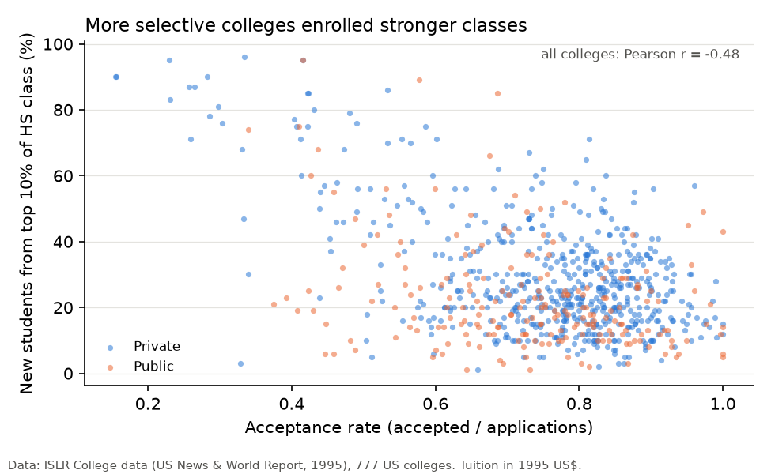

# Data Analytics Portfolio

[](https://github.com/yding-lab/Data-Analytics-Portfolio/actions/workflows/notebooks.yml)

Analytics foundations in Python, SQL and R: data cleaning, exploratory analysis, hypothesis testing, visualization, SQL querying, web scraping and testing. One lead analysis and six shorter skill notebooks, all of which run top to bottom from a clean kernel (checked in CI on every push).

> This repository shows analytics fundamentals. For machine-learning and AI engineering work, see my other repositories.

## Lead project: college admissions and tuition (1995)

[`notebooks/01_college_admissions_analysis.ipynb`](notebooks/01_college_admissions_analysis.ipynb)

**Questions.**
1. Do private institutions charge more than public ones?
2. Do larger ones?
3. Is selectivity related to the academic profile of incoming students?
4. Is it related to faculty credentials?
5. Is tuition related to how many applications an institution receives?

**Data.** 777 US colleges, 18 variables, from the **1995** issue of US News & World Report. This is the `College` data from the ISLR R package v1.4 (James, Witten, Hastie & Tibshirani), originally from CMU StatLib. It's distributed under GPL-2 and isn't committed here: `python get_college_data.py` downloads it from the pinned package version.

**Cleaning choices.**
- Columns are standardized to snake_case and college names are used as the index.
- The data was checked for duplicates and missing values (none).
- Acceptance rate is `accept / apps`, defined only when there are applications.
- "Large" means new-student enrollment above the mean of 780.

**Statistical analysis.**
- Welch's t-test and Mann-Whitney U for the group comparisons.
- Pearson correlation with Spearman as a rank-based robustness check, because application counts are heavily skewed.
- Effect sizes are reported alongside p-values.

**Findings** (all figures describe 1995):

| Question | Result |
|---|---|
| Private vs public tuition | Private mean $11,802 vs public $6,813 out-of-state; medians $11,200 vs $6,609 (p < 10⁻⁶⁰) |
| Size vs tuition | Overall, large institutions are *cheaper*: median $7,822 vs $10,520. That's a public/private effect, since 151 of the 218 large institutions are public. **Within each type the direction reverses**: large private colleges have a median of $14,235 vs $11,005 for small ones, and large public ones $6,806 vs $6,297 (Simpson's paradox). Enrollment vs tuition: r = −0.155 |
| Selectivity vs student profile | Acceptance rate vs share of top-10% students: r = −0.479 (moderate) |
| Selectivity vs faculty credentials | Acceptance rate vs share of PhD faculty: r = −0.318, p < 10⁻¹⁸. Significant but weak (r² = 0.10) |
| Tuition vs applications | r = 0.050, p = 0.16: no evidence of a relationship |

**Key figures.** These are written by section 13 of the notebook from the same data, with tuition in 1995 US dollars.



*Private colleges charged more.* The median out-of-state tuition was $11,200 at private colleges (n = 565) and $6,609 at public ones (n = 212). The two distributions barely overlap in their middle halves.



*Size alone is misleading.* Pooled, large colleges look cheaper. Split by type, large colleges charge more in both groups, and the pooled result is a mix effect: most large colleges are public. This still isn't a causal size effect, because large private colleges are often well-resourced research universities.



*Selective colleges enrolled stronger classes.* Acceptance rate and the share of new students from the top 10% of their high-school class are moderately negatively correlated (r = −0.48). Of the 17 colleges that accepted fewer than 35% of applicants, 16 were private.

**Limitations.** These are observational, single-year (1995) results, and correlations aren't causal. Apart from the within-type split above, confounders such as institutional wealth, reputation and location aren't controlled. The notebook ends with suggested next steps (multivariate models, controls for selectivity and resources).

## Skill notebooks

| Notebook | Shows | Data | Runs where |
|---|---|---|---|
| [02 SQL: employee/manager analysis](notebooks/02_sql_employee_manager_analysis.ipynb) | DDL with constraints, filters, `LIKE`, joins with computed columns, nested subqueries (second-highest distinct salary) | Small sample tables created in the notebook (fictional) | Anywhere (in-memory SQLite) |
| [03 Data wrangling with pandas](notebooks/03_data_wrangling_with_pandas.ipynb) | Selection, filtering, missing values, groupby, sorting, pivot tables | Small fictional dataset defined in the notebook | Anywhere |
| [04 Data visualization with Matplotlib](notebooks/04_data_visualization_with_matplotlib.ipynb) | Custom scatter plot, four-variable bubble chart, dual-axis chart | Illustrative values defined in the notebook | Anywhere |
| [05 Web scraping](notebooks/05_web_scraping.ipynb) | `requests` + BeautifulSoup table parsing, cleaning, analysis, a chart | Scraped live from NationMaster (households with a TV, survey years 1987–2005). Nothing is stored; check the site's terms before reuse | Needs internet. Outputs aren't committed; CI runs it on every push |
| [06 Python and R function practice](notebooks/06_python_r_function_practice.ipynb) | The same algorithms in Python and R, indexing differences, O(n²) → O(n) Two Sum, assertions | None | Python cells anywhere; R cells need R + `rpy2`. Outputs aren't committed; CI runs it |
| [07 Unit testing and regular expressions](notebooks/07_unit_testing_and_regular_expressions.ipynb) | `unittest` suite, regex word search and email extraction | Example text with `example.com` addresses | Anywhere |

## Run the notebooks

```bash
python -m venv .venv && source .venv/bin/activate
pip install -r requirements.txt          # add `rpy2` and install R for notebook 06's R cells
python get_college_data.py               # data for notebook 01 -> data/College.csv
jupyter lab notebooks/                   # then Kernel -> Restart & Run All

# or run everything headless, as CI does:
for nb in notebooks/*.ipynb; do jupyter nbconvert --to notebook --execute --output-dir executed "$nb"; done
```

The committed outputs of notebooks 01–04 and 07 come from a clean-kernel run in a fresh virtual environment built from `requirements.txt`, and their written conclusions were checked against those outputs. Notebook 01 also writes the README figures to `figures/`.
